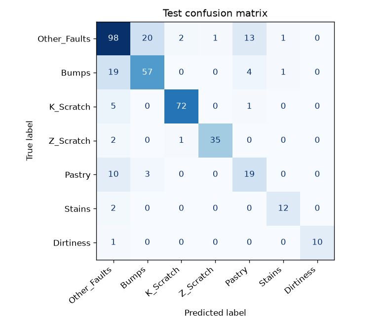
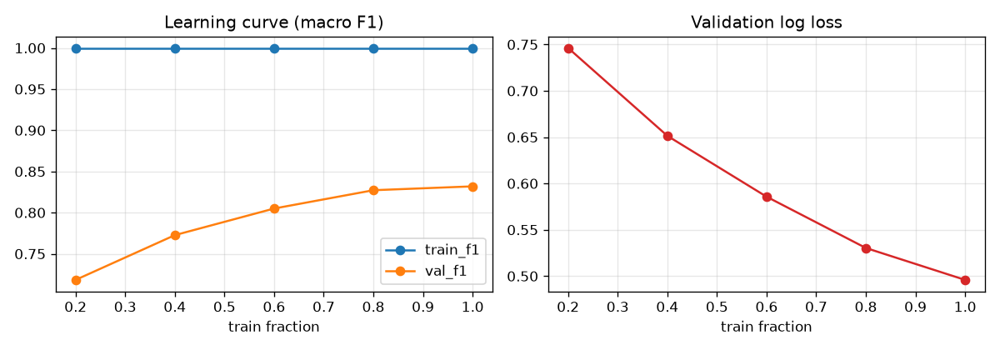
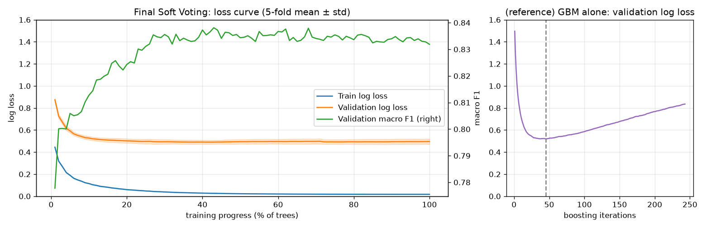

# Steel Plate Fault Classification

강판 표면 결함의 측정값 27개로 결함 7종을 분류하는 머신러닝 프로젝트입니다.
팀 프로젝트(5인)에서 모델링을 맡아 진행한 작업을 개인 저장소로 다시 정리했습니다.

- Baseline(XGBoost) 대비 반복 CV Macro F1 **0.8143 → 0.8368**, 처음 보는 생산 조건(그룹 CV) **0.7197 → 0.7572**
- 같은 생산 조건의 결함이 Train·Test에 섞인 구조를 발견하고, **그룹 교차검증**으로 처음 보는 생산 조건에서의 성능을 따로 측정
- 생산 조건을 외우게 만드는 파생변수(`plate_defect_count`)를 찾아 제외 → 처음 보는 조건의 Macro F1 **0.7182 → 0.7572**

| 항목 | 내용 |
|---|---|
| 데이터 | [UCI Steel Plates Faults](https://archive.ics.uci.edu/dataset/198/steel+plates+faults) · 1,941건, 결함 7종 |
| 문제 | 다중 분류 (가장 많은 유형과 가장 적은 유형의 건수 차이 약 12배) |
| 평가 지표 | Macro F1 (모든 유형을 같은 비중으로 평가) |
| 검증 | 80:20 층화 분할, Train 내부 5-fold CV · 반복 CV(5×3) · 그룹 CV / Test는 최종 1회 평가 |
| 최종 모델 | ExtraTrees + GBM **Soft Voting** · 피처 35개(원본 26 + 파생 9) · SMOTENC(ET) + 클래스 가중치 |

## 결과

| 모델 | 5-fold CV | 반복 CV (5×3) | 그룹 CV (5×3) | Test |
|---|---:|---:|---:|---:|
| Baseline (XGBoost 기본값) | 0.8109 | 0.8143 | 0.7197 | 0.8165 |
| **최종 모델** | **0.8319** | **0.8368** | **0.7572** | **0.8109** |

- Test Macro F1 95% 신뢰구간: 0.7663 – 0.8487 (부트스트랩), Accuracy 0.7789
- Test 유형별 F1: K_Scratch 0.9412 · Z_Scratch 0.9459 · Dirtiness 0.9524 · Stains 0.8571 · Other_Faults 0.7206 · Bumps 0.7081 · Pastry 0.5507
- **Test 해석:** Test는 389건이라 신뢰구간이 ±0.04로 넓어, Baseline Test(0.8165)와의 차이는 이 범위 안입니다. 또 Test 결함의 93.8%가 Train에 같은 생산 조건이 있어, 그 조건을 외우는 `plate_defect_count` 포함 버전에 유리한 구성입니다(포함 버전 Test 0.8350). 모델은 15 fold CV와 그룹 CV로 정했고, Test 결과를 보고 바꾸지 않았습니다.



## 접근 과정

| 단계 | 내용 | Macro F1 |
|---|---|---:|
| Baseline | 6개 모델 비교 → 부스팅 계열 우세 (GBM 기본값) | 0.7958 |
| 불균형 처리 | 클래스 가중치·SMOTENC·언더샘플링 비교 → GBM은 클래스 가중치 | 0.8092 |
| 튜닝 | RandomizedSearchCV (원본 26개 피처) | 0.8275 |
| 파생변수 + 재튜닝 | 형상·밝기·위치·강판 맥락 파생변수 10개 추가 후 다시 튜닝 | 0.8401 |
| 앙상블 | 5개 튜닝 모델의 Soft Voting 조합 비교 → ExtraTrees + GBM | 0.8448 |
| 일반화 점검 | 그룹 CV에서 `plate_defect_count`가 새 조건 성능을 떨어뜨림 → 제외 후 재튜닝 | 반복 CV 0.8391 → 0.8368 (동률) · 그룹 CV 0.7182 → **0.7572** |

(Train 5-fold CV 기준, 마지막 행만 같은 분할의 15 fold 비교. 0.8448은 조합 26개 중 1등을 고른 값이라 낙관적이므로, 포함·제외는 반복 CV로 비교했습니다.)

- **누수 방지:** 전처리·샘플링·가중치·집계형 파생변수는 모두 Pipeline 안에 넣어 학습 fold로만 계산했습니다.
- **모델 선택:** 5-fold 최고값은 여러 설정 중 1등을 고른 값이라 낙관적이므로, 후보 간 비교는 반복 CV(15 fold) 평균으로 했습니다.
- **불균형 처리:** 언더샘플링은 학습 데이터가 1/5로 줄어 크게 나빠졌습니다. 오버샘플링·가중치는 소수 유형 Recall을 올리는 대신 Other_Faults를 더 놓치는, 판정 경계를 옮기는 효과였습니다.
- **파생변수:** 파라미터를 고정한 채 변수만 추가하면 효과가 거의 없었고, 다시 튜닝했을 때 개선됐습니다.
- **앙상블 조합:** ExtraTrees + RandomForest + GBM과 반복 CV 차이가 0.0002로 사실상 동률이라, 더 단순한 2개 조합을 골랐습니다.

## 일반화 점검: 처음 보는 생산 조건

- 같은 생산 조건(폭·두께·강종) 안에서 같은 결함이 몰려 나오고(그룹 내 최다 유형 비율 0.763, 무작위 섞기 시 0.43), Test 결함의 93.8%가 Train에 같은 조건이 있습니다.
- 그래서 무작위 분할 점수는 "이미 본 조건" 기준의 성능입니다. 같은 조건이 학습·검증 한쪽에만 들어가도록 나누는 **그룹 교차검증**(StratifiedGroupKFold)으로 새 조건에서의 성능을 따로 측정했습니다.

| 모델 | 무작위 분할 (5×3) | 그룹 분할 (5×3) | 하락 |
|---|---:|---:|---:|
| Baseline XGBoost | 0.8143 | 0.7197 | −0.0946 |
| ET + GBM, `plate_defect_count` 포함 (36개) | 0.8391 | 0.7182 | −0.1209 |
| **ET + GBM, `plate_defect_count` 제외 (35개, 최종)** | 0.8368 | **0.7572** | **−0.0796** |

- `plate_defect_count`(학습 데이터에서 같은 생산 조건의 결함 수)는 이미 본 조건에서는 조건의 이름표처럼 쓰이지만, 새 조건에서는 항상 0이 되어 오히려 방해가 됩니다. 포함 버전은 새 조건에서 Baseline보다도 낮았습니다.
- 이 변수만 빼고 다시 튜닝하면 이미 본 조건에서는 동률 수준(−0.0023, 15 fold 중 7개에서 우세), 새 조건에서는 +0.0390(15 fold 중 11개에서 우세)입니다.
- **선택 기준:** 이미 본 조건 성능이 동률이면 처음 보는 조건 성능이 높은 쪽 → 제외 버전을 최종 모델로 정했습니다. 이 결정은 모두 Train 안의 CV로 내렸고, Test는 그 뒤에 한 번만 평가했습니다.
- 최종 모델 기준으로 그룹 분할에서 가장 크게 떨어지는 유형은 Dirtiness(−0.0985), Pastry(−0.0713), Other_Faults(−0.0711)입니다. Stains는 거의 떨어지지 않습니다.

## 검증과 해석

**과적합 점검**



- 학습 데이터를 20%에서 100%로 늘리면 검증 F1은 0.7183에서 0.8319로 오르고, 검증 Log Loss는 0.7463에서 0.4959로 내려갑니다. 데이터가 늘면 더 좋아질 여지가 있는 상태로, 분류 성능 기준의 과적합은 보이지 않습니다.


- 최종 Soft Voting은 트리를 늘릴수록 학습·검증 손실이 함께 내려가다가, 30% 이후 검증 손실이 0.49–0.50에서 평탄하게 수렴합니다(최저 0.4908, 100% 0.4959). 검증 F1도 0.83–0.84 범위를 유지해 다시 떨어지지 않습니다.
- 참고로 GBM 단독은 45회 부근에서 검증 손실이 최저(0.5201)였다가 243회까지 0.8356으로 오릅니다. 맞히는 유형은 그대로인데 확률을 점점 과신하는 현상으로, Soft Voting에서는 ExtraTrees의 완만한 확률이 이를 상쇄합니다.

**오류 구조**

- Test 오분류 86건 중 39건이 Bumps ↔ Other_Faults, 23건이 Pastry ↔ Other_Faults입니다.
- 오류가 서로 닮은 세 유형의 경계에 집중되어 있습니다. 건수가 가장 적은 Stains·Dirtiness는 오히려 잘 맞힙니다.

**변수 중요도 (Permutation)**

- 상위: 두께 0.1010 · 폭 0.0896 · x_center_rel 0.0237 · 강종 0.0187 (Test Macro F1 감소량)
- `plate_defect_count` 포함 버전(두께 0.1780 · 폭 0.1296 · 강종 0.0977)보다 생산 조건 의존도가 크게 줄었습니다.

## 한계

- 생산 조건 그룹은 강판 번호가 없어 폭·두께·강종 조합으로 추정했습니다. 같은 라인의 다른 규격이 섞여 있다면 그룹 CV도 낙관적일 수 있습니다.
- Pastry는 Other_Faults와 구분이 잘 되지 않습니다. Other_Faults가 여러 결함을 모은 범주라 정답 체계 자체의 한계로 보입니다.
- Test의 소수 유형 건수가 적어(Dirtiness 11건, Stains 14건) 유형별 점수의 불확실성이 큽니다.
- GBM의 확률이 과신 경향이 있어, 예측 확률로 "검사자 재확인" 기준을 정하려면 확률 보정(calibration)이 필요합니다.

## 구조

```
├── pyproject.toml · uv.lock        # uv 환경 (의존성 버전 고정)
├── data/Faults.csv                 # UCI 원본
├── src/steel.py                    # 데이터 로드·전처리·파생변수·모델 래퍼·최종 모델
├── notebooks/
│   ├── 01_data_eda.ipynb                  # 품질 점검, 클래스 분포, 생산 조건 구조
│   ├── 02_baseline_imbalance.ipynb        # Baseline 6개 모델, 불균형 처리 비교
│   ├── 03_features_tuning_ensemble.ipynb  # 파생변수, 튜닝, Soft Voting 조합, 반복 CV
│   ├── 04_generalization.ipynb            # 그룹 교차검증, plate_defect_count 제외 재튜닝 → 최종 피처 결정
│   └── 05_final_model.ipynb               # 최종 모델 CV·과적합 점검·Test 평가·저장
├── dashboard/
│   ├── app.py                      # Streamlit 대시보드
│   ├── build_data.py               # 대시보드용 결과 파일 생성
│   └── data/                       # 대시보드가 읽는 결과 (CSV·JSON)
├── figures/                        # 결과 그림
└── results/cache/                  # 튜닝·CV 계산 캐시 (git 제외)
```

## 실행

[uv](https://docs.astral.sh/uv/)로 가상환경과 패키지를 관리합니다 (Python 3.14, 버전은 `uv.lock`에 고정).

```bash
uv sync      # .venv 생성 + 패키지 설치 → VS Code에서 노트북 커널로 .venv 선택
```

노트북은 01부터 순서대로 실행합니다. 05는 단독으로 실행할 수 있습니다(최종 파라미터는 `src/steel.py`에 고정).
튜닝·CV 결과는 `results/cache/`에 저장되어 두 번째 실행부터는 빠르게 끝납니다.

## 대시보드 (Streamlit)

데이터 특성, 모델별 평가 지표, 불균형 처리 전후, 최종 모델 결과를 한 화면에서 확인할 수 있습니다.

```bash
uv run streamlit run dashboard/app.py      # 브라우저에서 http://localhost:8501
```

| 탭 | 내용 |
|---|---|
| 데이터 | 클래스 분포(Train/Test), 유형별 변수 분포, 생산 조건 구조 |
| 모델 비교 | 단계별 모델의 5-fold 지표(Macro F1·Accuracy·Precision·Recall), Soft Voting 조합, 무작위 vs 그룹 분할 |
| 불균형 처리 | 처리 방법 × 모델 Macro F1, 처리 전후 유형별 Recall·Precision·F1 |
| 최종 모델 | Confusion Matrix, 유형별 지표, 변수 중요도, 학습·손실 곡선 |

대시보드는 `dashboard/data/`의 결과 파일을 읽습니다. 노트북을 다시 실행해 결과가 바뀌었다면 아래로 다시 만듭니다.

```bash
uv run python dashboard/build_data.py      # results/cache/와 models/final_model.pkl 필요
```

## 배운 점

- **점수는 재는 방법과 함께 읽어야 합니다.** 한 번의 5-fold에서 보인 차이가 반복 CV에서는 사라지기도 했고, 무작위 분할과 그룹 분할의 차이는 모델 간 차이보다 컸습니다.
- **좋은 점수가 좋은 일반화를 뜻하지는 않습니다.** 이미 본 조건에서 점수를 올린 변수가 새 조건에서는 오히려 성능을 떨어뜨렸습니다.
- **"적은 유형"과 "어려운 유형"은 다릅니다.** 성능을 막는 것은 건수가 적은 유형이 아니라 서로 닮은 유형의 경계였습니다.
- **변수를 바꾸면 하이퍼파라미터도 다시 맞춰야 합니다.** 파생변수의 효과는 재튜닝 후에 나타났습니다.
